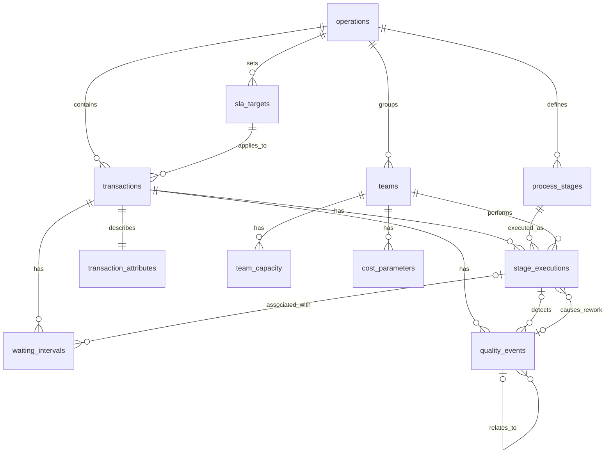
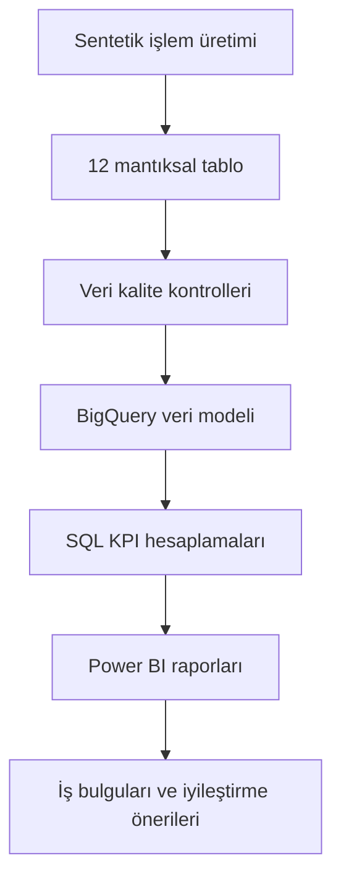

# Veri Modeli ve Tablo İlişkileri

**Proje:** Bankacılık Operasyonları ve Süreç Analitiği  
**Kurgusal kurum:** NovaBank  
**Sürüm:** 1.0  
**Durum:** Mantıksal tasarım; fiziksel uygulama bekleniyor

## 1. Modelin amacı

Bu veri modeli; işlemlerin yaşam döngüsünü, aşama ziyaretlerini, beklemeleri, kalite olaylarını, ekip kapasitesini ve tahmini maliyetleri birbirleriyle ilişkili şekilde analiz etmek için tasarlanmıştır.

Toplam 12 mantıksal tablo bulunur. Model, sentetik veri üretimi ve BigQuery analizleri için temel oluşturur.

## 2. Ana tablo ilişkileri

| Ana tablo | İlişkili tablo | İlişki | Bağlantı alanı |
|---|---|---|---|
| operations | transactions | 1:N | operation_id |
| operations | process_stages | 1:N | operation_id |
| operations | sla_targets | 1:N | operation_id |
| operations | teams | 1:N | operation_id (birincil operasyon) |
| transactions | stage_executions | 1:N | transaction_id |
| transactions | waiting_intervals | 1:N | transaction_id |
| transactions | quality_events | 1:N | transaction_id |
| transactions | transaction_attributes | 1:1 | transaction_id |
| process_stages | stage_executions | 1:N | stage_id |
| teams | stage_executions | 1:N | team_id |
| teams | team_capacity | 1:N | team_id |
| teams | cost_parameters | 1:N | team_id |
| stage_executions | waiting_intervals | 1:N (isteğe bağlı) | execution_id |
| stage_executions | quality_events | 1:N (isteğe bağlı) | execution_id |
| quality_events | stage_executions | 1:N (isteğe bağlı) | related_quality_event_id |
| quality_events | quality_events | 1:N (isteğe bağlı) | root_event_id |
| sla_targets | transactions | 1:N | sla_target_id |

## 3. Mantıksal ilişki diyagramı

Aşağıdaki Mermaid diyagramı GitHub üzerinde görselleştirilebilir.

## 4. İşlem yaşam döngüsü

1. Yeni bir işlem transactions tablosuna kaydedilir.
2. İşlem açılışındaki özellikler transaction_attributes tablosunda saklanır.
3. Karmaşıklık seviyesi belirlenir ve geçerli sla_targets kaydı işleme atanır.
4. İşlem aşamaları stage_executions tablosunda ziyaret bazında tutulur.
5. İç ve dış beklemeler waiting_intervals tablosunda kaydedilir.
6. Hata veya iade gerçekleşirse quality_events tablosuna olay eklenir.
7. Yeniden çalışma gereken aşamalar yeni ziyaret kayıtlarıyla temsil edilir.
8. İşlem tamamlandığında transactions kapanış zamanı ve durumu güncellenir.
9. Aktif süreler ekip ve gün bazında kapasiteyle karşılaştırılır.
10. Maliyetler geçerli cost_parameters kayıtları üzerinden hesaplanır.

## 5. İlişki ve hesaplama kuralları

### İşlem ve aşama tutarlılığı

Bir aşama ziyareti, işlemin ait olduğu operasyonun aşamalarından biri olmalıdır. Tekrar ziyaretler aynı işlem ve aşama için visit_number ile ayrılır.

### Beklemeler

waiting_intervals, işlem seviyesinde zorunlu transaction_id içerir. Aşama içi beklemelerde execution_id kullanılabilir; aşamalar arası beklemelerde NULL olabilir.

### Kalite olayları

Bir kalite olayı birden fazla yeniden işlem ziyaretine neden olabilir. Yeniden işlem ziyaretleri is_rework ve related_quality_event_id ile ilişkilendirilir. Hata sayısı aşama ziyareti sayısından türetilmez.

### SLA

Uçtan uca süre iş takvimi içinde açılıştan kapanışa kadar geçen süredir. Operasyonel süre, yalnızca doğrulanmış ve hariç tutulabilir dış taraf veya müşteri beklemeleri çıkarılarak hesaplanır. İki ölçüm aynı açılışta belirlenen SLA hedefiyle karşılaştırılır.

### Kapasite

Ekip-gün aktif dakikaları stage_executions üzerinden türetilir ve team_capacity ile karşılaştırılır. Çok güne yayılan çalışmalar ilgili günlere dağıtılmalıdır.

### Maliyet

Tahmini maliyet, aktif çalışma süreleri ve ilgili tarihte geçerli ekip maliyet parametreleri üzerinden hesaplanır. Tamamlanan işlem başına maliyet analizinde yalnızca tamamlanan işlemlere atfedilen maliyetler kullanılmalıdır.

## 6. Raporlama kesiti

Ana raporlama kesiti 31.12.2025'tir. Kesit anında açık olan işlemler açık olarak değerlendirilir. Kesitten sonraki kapanışlar, beklemeler ve kalite olayları geçmiş tarihli raporlara yansıtılmaz.

## 7. Veri akışı

## 8. Fiziksel uygulama öncesi açık konular

- Aktif çalışmanın ekip ve gün bazında zaman aralığıyla doğrulanması
- Normal mesai ve fazla mesai ayrımının hesaplanması
- İşlem ve bekleme aralıklarının çakışma kontrolleri
- Açık işlemlerin raporlama kesitinde doğru hesaplanması
- Operasyona özgü karmaşıklık sınıflandırma kuralları

Bu konular, teknik geliştirme başlamadan önce küçük test verisi üzerinde doğrulanacaktır.
