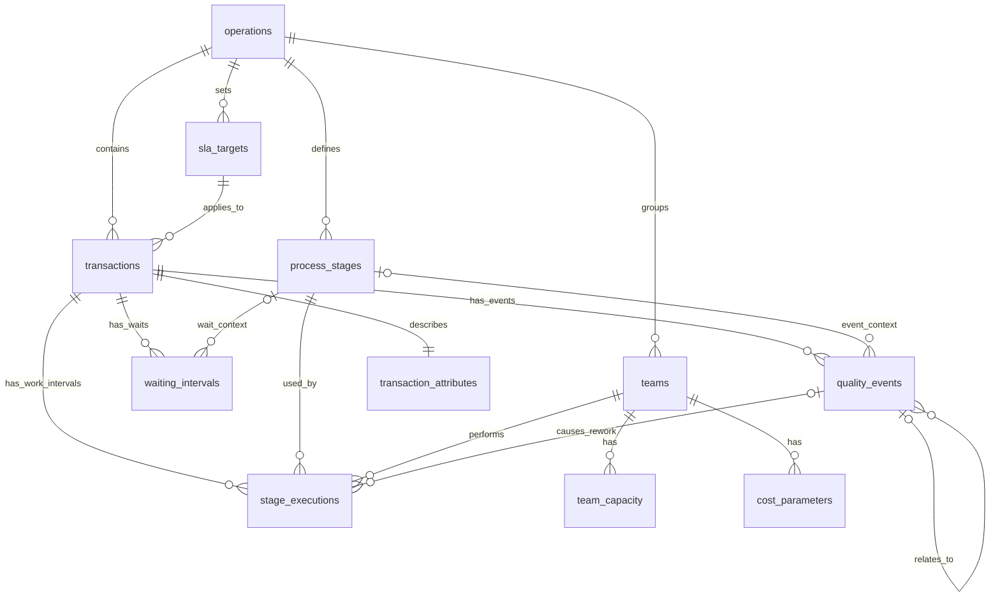
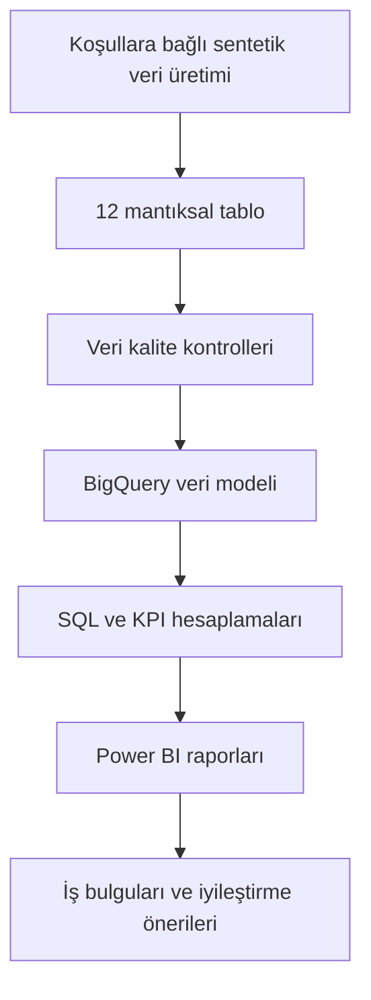

# Veri Modeli ve Tablo İlişkileri — Banking Operations & Process Intelligence

**Proje:** Bankacılık Operasyonları ve Süreç Analitiği  
**Kurgusal kurum:** Veriqora Bank  
**Sürüm:** 1.2  
**Durum:** Mantıksal model belgelendi; sentetik veri ve beş senaryolu raporlama üretildi. BigQuery ve Power BI uygulamaları ayrı aşamalardır  
**Veri kaynağı:** Tamamen sentetik; gerçek banka, müşteri veya çalışan verisi içermez.

## 1. Modelin amacı

Bu veri modeli; işlemlerin yaşam döngüsünü, aşama ziyaretlerini, aktif çalışma aralıklarını, beklemeleri, kalite olaylarını, ekip kapasitesini ve tahmini işçilik maliyetlerini ilişkili biçimde analiz etmek için tasarlanmıştır.

Toplam **12 mantıksal tablo** bulunur. Model, koşullara bağlı sentetik veri üretimi, BigQuery analizleri ve Power BI raporları için temel oluşturur. Teknik adlar İngilizce, iş açıklamaları Türkçedir. Zaman damgaları `TIMESTAMP` olarak saklanır; iş takvimi `Europe/Istanbul` saat dilimiyle yorumlanır.

## 2. Ana tablo ilişkileri

| Ana tablo | İlişkili tablo | İlişki | Bağlantı alanı / açıklama |
|---|---|---|---|
| operations | transactions | 1:N | operation_id |
| operations | process_stages | 1:N | operation_id |
| operations | sla_targets | 1:N | operation_id |
| operations | teams | 1:N | operation_id (ekibin birincil operasyonu) |
| sla_targets | transactions | 1:N | sla_target_id |
| transactions | transaction_attributes | 1:1 | transaction_id |
| transactions | stage_executions | 1:N | transaction_id; bir satır bir aktif çalışma aralığı |
| transactions | waiting_intervals | 1:N | transaction_id |
| transactions | quality_events | 1:N | transaction_id |
| process_stages | stage_executions | 1:N | stage_id |
| teams | stage_executions | 1:N | team_id |
| teams | team_capacity | 1:N | team_id; ekip-gün benzersiz |
| teams | cost_parameters | 1:N | team_id; geçerlilik aralığıyla |
| Aşama ziyareti (mantıksal) | stage_executions | 1:N | (transaction_id, stage_id, visit_number) |
| Aşama ziyareti (mantıksal) | waiting_intervals | 1:N, isteğe bağlı | (transaction_id, stage_id, visit_number); üçlü yerine transaction_id düzeyinde bekleme de mümkün |
| Aşama ziyareti (mantıksal) | quality_events | 1:N, isteğe bağlı | (transaction_id, stage_id, visit_number); işlem düzeyinde kalite olayı da mümkün |
| quality_events | stage_executions | 1:N, isteğe bağlı | related_quality_event_id → event_id; yeniden işlem bağlantısı |
| quality_events | quality_events | 1:N, isteğe bağlı | root_event_id → event_id |

**Önemli:** Aşama ziyareti ayrı bir fiziksel tablo değildir. `(transaction_id, stage_id, visit_number)` birleşimi, aynı aşamaya belirli bir girişin **mantıksal kimliğidir**. `stage_executions` içinde bu üçlü birden fazla satırda tekrar edebilir; her satırın `execution_id` değeri benzersizdir. `waiting_intervals` ve `quality_events` içinde `stage_id` ile `visit_number` birlikte dolu veya birlikte NULL olur. Aşama bağlantısı NULL olduğunda olay işlem düzeyindedir. Üçlünün tutarlılığı veri kalite testleriyle doğrulanır.

## 3. Mantıksal ilişki diyagramı

Aşağıdaki Mermaid ER diyagramı **12 fiziksel tabloyu** gösterir. Üçlü anahtarla tanımlanan mantıksal aşama ziyareti ayrı bir varlık olarak çizilmez; açıklaması diyagramın altındadır.

**Diyagramı okuma notları:** `process_stages` ile `waiting_intervals` / `quality_events` arasındaki kesik olmayan çizgiler, `stage_id` üzerinden **isteğe bağlı bağlam ilişkisini** temsil eder; gerçek ziyaret bağlantısı için ayrıca `transaction_id` ve `visit_number` birlikte kontrol edilir. `business_calendar` olay zamanlarını iş dakikasına dönüştüren bağımsız takvim boyutudur; `cost_parameters` ile eşleştirme `team_id` ve tarih aralığı üzerinden yapılır. `teams.operation_id` ekibin birincil uzmanlık alanıdır; farklı operasyonlara hizmet vermesini engellemez.

## 4. İşlem yaşam döngüsü

1. Yeni talep için `transactions` kaydı ve açılış özellikleri için `transaction_attributes` kaydı oluşturulur.
2. Karmaşıklık, yalnızca açılış özelliklerinden operasyona özel puanlarla hesaplanır: 0–2 `LOW`, 3–5 `MEDIUM`, 6 ve üzeri `HIGH`.
3. Açılış tarihinde geçerli `sla_targets` kaydı işleme atanır; sonradan değiştirilmez.
4. İşlem, `process_stages` içinde tanımlanan akışa girer. Her aşama ziyareti `(transaction_id, stage_id, visit_number)` ile tanımlanır.
5. Bir ziyarette birden fazla aktif çalışma aralığı olabilir. Her aralık `stage_executions` tablosunda ayrı `execution_id` ile kaydedilir.
6. İç kuyruk, onay, teknik, dış taraf ve müşteri beklemeleri `waiting_intervals` tablosuna yazılır. Bekleme, aktif çalışmayla çakışmaz.
7. Hata, iade veya düzeltme oluşursa `quality_events` kaydedilir. Gerektiğinde önceki aşamaya yeni `visit_number` ile dönülür ve `is_rework` işaretlenir.
8. İşlem tamamlanır, iptal edilir veya raporlama kesitinde açık kalır; `transactions` durumu buna göre yorumlanır.
9. Aktif çalışma aralıkları ekip-gün ve normal mesai/fazla mesai pencerelerine bölünerek `team_capacity` ile karşılaştırılır.
10. Tahmini maliyetler aktif çalışma aralıkları ve ilgili günün `cost_parameters` değerlerinden hesaplanır.

## 5. İlişki ve hesaplama kuralları

### 5.1 İşlem ve aşama tutarlılığı

Bir aşama, işlemin `operation_id` değerine uygun olmalıdır. Aynı işlem ve aşamadaki `visit_number` değerleri 1'den başlayıp ardışık ilerler. **Tekil aşama ziyareti** ile **aktif çalışma aralığı** farklı kavramlardır: bir ziyarette birçok `stage_executions` kaydı bulunabilir. Bir ziyaretin tüm aktif aralıklarında yeniden işlem işaretleri ve ilişkili kök olay tutarlı olmalıdır. Aşama ziyareti durumunu yalnızca tek bir aktif aralığın `execution_status` alanı belirlemez.

### 5.2 Beklemeler

`waiting_intervals.transaction_id` zorunludur. İlgili aşama/ziyaret biliniyorsa `stage_id` ve `visit_number` birlikte doldurulur; aşamalar arası beklemelerde ikisi de NULL olabilir. Artık `execution_id` üzerinden bağlantı kurulmaz. Çakışan beklemeler süre hesaplarında birleştirilir ve çift sayılmaz. Beklemeler, aktif çalışma aralıklarıyla çakışamaz. Açık beklemelerde `ended_at` NULL olabilir ve hesaplamada raporlama kesiti üst sınır alınır.

### 5.3 Kalite olayları ve yeniden işlem

`quality_events`, işlem veya mantıksal aşama ziyareti düzeyinde tutulur; tek bir aktif çalışma aralığına bağlı değildir. Bir kök hata birden fazla yeniden işlem ziyaretine yol açabilir. İlgili aktif çalışma kayıtlarında `is_rework = TRUE` ve `related_quality_event_id` kullanılır. Hata olayı, düzeltme aksiyonu ve yeniden işlem ziyareti ayrı kavramlardır; hata sayısı tekrar ziyaret sayısından türetilmez. FTR yalnızca değerlendirmeye uygun tamamlanmış işlemler için hesaplanır.

### 5.4 SLA ve iş takvimi

İş takvimi Türkiye 2025 resmî tatilleri ve yarım günleriyle uyumludur. Normal günlerde 09.00–12.00 ve 13.00–18.00 (**480 dakika**), yarım günlerde 09.00–12.00 (**180 dakika**) çalışılır; tatil ve hafta sonlarında normal iş dakikası sıfırdır. 2026'ya taşan kapanışlar için gerekli 2026 takvimi de oluşturulur.

- **Uçtan uca SLA süresi:** Açılış ile kapanış (açık işlemde raporlama kesiti) arasındaki iş dakikaları.
- **Operasyonel SLA süresi:** Uçtan uca iş dakikalarından, yalnızca `EXTERNAL_PARTY` veya `CUSTOMER` türünde olup `is_excludable = TRUE` ve `reason_verified = TRUE` olan beklemelerin birleşik iş dakikaları çıkarılır.
- **SLA hedefi:** Açılışta belirlenen `sla_target_id` üzerinden alınır; tamamlanmış ve açık işlemler ayrı değerlendirilir.

İç kuyruk, iç onay ve teknik beklemeler operasyonel SLA'dan çıkarılmaz. Operasyonel süre negatif olamaz. İş saatleri dışında fiilen yapılan çalışma fazla mesai olarak kaydedilebilir; ancak SLA iş takvimi bu saatlerde ilerlemez.

### 5.5 Açık ve tamamlanan işlemler

Ana raporlama kesiti **31.12.2025 18.00 Europe/Istanbul** olarak sabittir. Kesitte kapanmamış işlem `OPEN` sayılır; gelecekteki kapanış veya kalite olayları geçmiş KPI'ları değiştirmez. `COMPLETED`, `CANCELLED` ve `OPEN` durumları ayrıdır. İptal edilen işlemler tamamlanma başarısı ve FTR paydasına otomatik olarak dahil edilmez.

Açık işlemler için operasyonel SLA hedef kullanımı **%80 altı normal**, **%80–%100 risk altında**, **%100 üzeri gecikmiş** olarak sınıflandırılır. Dış bekleme etkisi ayrıca işaretlenir. Açık işlemlerin kalan aktif iş yükü, benzer tamamlanmış işlemlere göre tahmin edilir; gerçekleşmiş süre gibi gösterilmez.

### 5.6 Ekip kapasitesi ve fazla mesai

`team_capacity` tablosunun benzersiz anahtarı `(team_id, capacity_date)` birleşimidir. `employee_count` o gün kullanılabilir çalışan sayısını, `available_minutes` normal mesai kapasitesini, `overtime_capacity_minutes` ise **planlanan/izin verilen** ek mesai kapasitesini ifade eder. Gerçekleşen fazla mesai, `stage_executions` zaman aralıklarından türetilir.

- **Normal kapasite kullanımı:** Normal mesai içinde gerçekleşen aktif dakikalar / normal kapasite.
- **Fazla mesai payı:** Fazla mesai aktif dakikaları / toplam aktif dakikalar.
- **Toplam iş yükü / normal kapasite:** (Normal + fazla mesai aktif dakikaları) / normal kapasite; %100'ü aşabilir.

Normal kapasite sıfırsa oranlar `NULL` olarak gösterilir. Eşzamanlı aktif çalışma yükü, o anda kullanılabilir ekip çalışanı sayısını aşamaz. Zaman aralıkları takvim günü ve mesai pencerelerine bölünmeden ekip-gün hesabı yapılmaz.

### 5.7 Tahmini maliyet

Tahmini işçilik maliyeti = **normal aktif saat × geçerli saatlik maliyet + fazla mesai aktif saat × saatlik maliyet × fazla mesai çarpanı**. `cost_parameters` geçerlilik tarihleri ve `team_id` birlikte kullanılır. Örnek sentetik varsayım: normal saatlik maliyet 600 TL ve fazla mesai çarpanı 1,5; gerçek ücret veya bordro verisi değildir. Yeniden işlem maliyeti, ilgili aktif çalışma aralıklarının maliyetidir; toplam maliyete ikinci kez eklenmez. Tamamlanan işlem başına maliyette yalnızca tamamlanmış işlemlere atfedilen maliyetler kullanılır.

## 6. Raporlama kesiti ve veri bütünlüğü

- Ana kesit: **31 Aralık 2025, saat 18.00 (Europe/Istanbul)**.
- Kesitten sonraki olaylar geçmiş dönem raporlarına yansıtılmaz.
- Açık aktif çalışma ve bekleme aralıkları hesaplama sırasında kesitle sınırlandırılır; saklanan orijinal olaylar değiştirilmez.
- Anahtarlar benzersiz ve geçerli; tarihler kronolojik; aşama/operasyon ilişkileri tutarlı olmalıdır.
- Aynı ekipte eşzamanlı aktif çalışma, kullanılabilir çalışan kapasitesini aşmamalıdır.
- Normal mesai, fazla mesai ve bekleme süreleri birbirine karıştırılmamalıdır.
- Aşama ziyaretlerine referans veren olayların üçlü anahtarları, `stage_executions` kayıtlarından türetilen ziyaretlerle eşleşmelidir.

## 7. Veri akışı

## 8. Pilot uygulama ve kabul kriterleri

Tasarımda önce **300 işlemlik pilot**, ardından 50.000 işlemlik 2025 veri seti öngörülmüştür; 50.000 işlemle senaryo simülasyonları ve raporlama gerçekleştirilmiştir. Pilot dağılımı: ödeme/transfer 90, bilgi güncelleme 60, hesap 54, kredi 45, yasal takip 30, operasyonel kontrol 21. Dağılımlar ve hata/bekleme/yeniden işlem olasılıkları kurgusal başlangıç varsayımlarıdır; SLA, maliyet ve FTR sonuçları rastgele atanmaz, olaylardan hesaplanır.

Pilot kabulü için anahtar ve yabancı anahtar bütünlüğü; açılışta karmaşıklığın yeniden hesaplanabilmesi; zaman sıralaması; aktif çalışma/bekleme çakışmaması; tatil, yarım gün ve yıl sonu kesiti; açık işlemler; normal/fazla mesai ayrımı; ekip eşzamanlı kapasite sınırı; kalite ve maliyette çift sayım olmaması; aynı seed ile tekrarlanabilirlik doğrulanır. Nadir sınır durumları ayrıca test senaryosu olarak eklenir ve normal dağılım istatistiklerine karıştırılmaz.

**Fiziksel uygulama notu:** Bu 12 tabloluk mantıksal tasarım, her aşama ziyaretinde en az bir aktif çalışma aralığı bulunmasını varsayar. Yalnızca bekleyen aşama ziyaretlerini ayrıca modellemek gerekirse bu varsayım yeniden değerlendirilmelidir.

**Uygulama durumu:** Python ile sentetik veri üretimi, senaryo simülasyonları ve rapor hesaplaması gerçekleştirilmiştir. SQL/BigQuery ve Power BI bileşenleri tamamlanmış olarak değerlendirilmemelidir. Güncel sonuçlar `reports/` klasöründeki üç dosyada yer alır.
